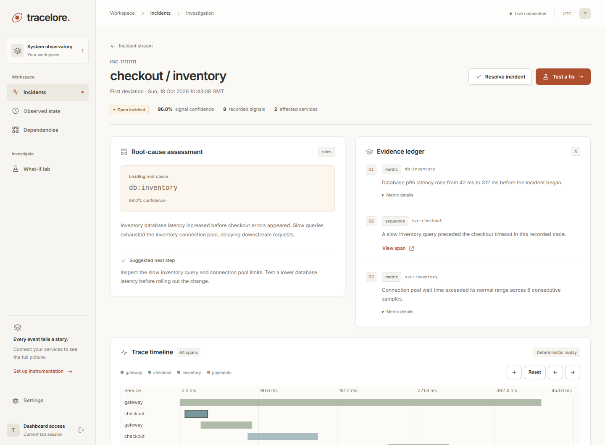
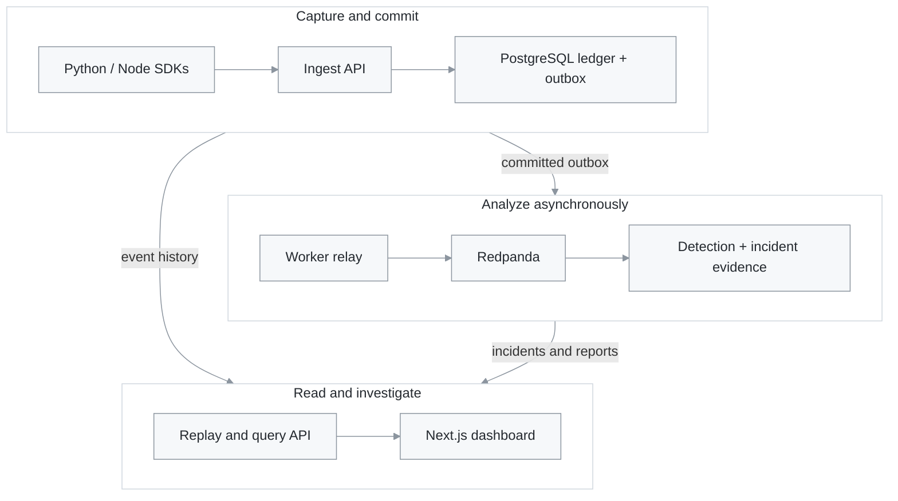
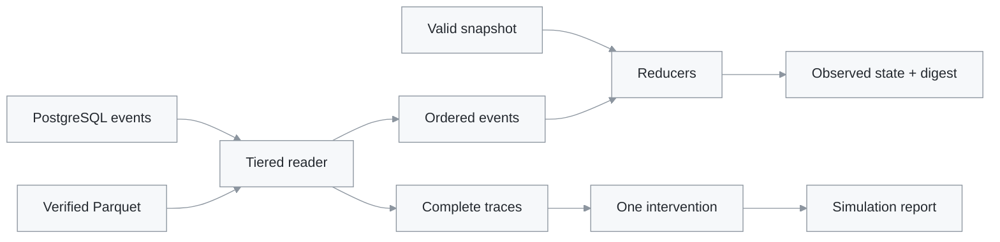

<div align="center">

# Tracelore

**Incident investigation with a verifiable event history.**

Collect service events, follow an incident back to its evidence,<br />
and explore a possible fix against the recorded traces.

[Python 3.11 / 3.12](backend/pyproject.toml) · [Next.js + TypeScript](dashboard/package.json) · [CI checks](https://github.com/arvindkumar-ship-it/Tracelore/actions/workflows/ci.yml) · [MIT](LICENSE)

[Run locally](#run-locally) · [Investigate an incident](#investigate-an-incident) · [Connect a service](#connect-a-service) · [Architecture](#architecture) · [Development](#development)

</div>

---

When a checkout slows down, the useful questions are specific: which dependency changed first, which spans support that conclusion, and would a different timeout or a faster query have helped?

Tracelore brings those questions into one self-hosted workspace. Python and Node SDKs capture events; an append-only PostgreSQL ledger preserves their history; background analysis builds incidents and root cause evidence. The dashboard connects that evidence to traces, observed state, and what-if simulations.



<sub>Actual dashboard, populated with the repository's UI test fixtures. The values shown are sample data, not benchmark results.</sub>

## What you can do

| Task | What Tracelore provides |
| --- | --- |
| **Understand an incident** | Metric change detection and unusual trace sequences, grouped into incidents with signal history. |
| **Inspect the evidence** | Ranked root cause candidates, dependency paths, and supporting event and metric references. |
| **Explore a trace** | A span waterfall with an event cursor and the observed state at that point. |
| **Test a possible fix** | Simulate a timeout change, cache hit rate change, or node latency multiplier on recorded traces. |
| **Check the history** | Per-stream hash chains, replay digests, snapshots, and verified Parquet archives. |

The default stack uses statistical baselines, an n-gram sequence model, and rule-based explanations. **No LLM API key is needed to start.** Neural models and LLM explanations are optional.

## Run locally

Use **Python 3.11 or 3.12**, **Git**, and **Docker with Compose v2**. On Windows, start Docker Desktop with Linux containers. Node.js is only needed on the host if you develop the dashboard or TypeScript SDK; the dashboard container uses Node 22.

### 1. Clone and generate local credentials

```sh
git clone https://github.com/arvindkumar-ship-it/Tracelore.git
cd Tracelore
python scripts/setup.py
```

Setup generates a gitignored `.env` containing database passwords, a dashboard secret, object storage credentials, and demo keys. It preserves an existing `.env`.

### 2. Start the application and demo services

```sh
docker compose --profile app --profile demo up -d --build --wait --wait-timeout 600
```

Compose starts PostgreSQL, Redis, Redpanda and MinIO, runs migrations and bootstrap, then starts ingestion, the API, workers, detector, dashboard, proxy, and three instrumented demo services. Bootstrap registers the demo ingest key and creates the Kafka topics. The first build can take several minutes.

<details>
<summary><strong>Windows PowerShell helper</strong></summary>

From the repository root, this helper performs setup and startup with checks between steps:

```powershell
Set-ExecutionPolicy -Scope Process Bypass
.\scripts\dev-up.ps1 -Demo
```

Add `-Monitoring` to include Prometheus and Grafana. Use `-App` instead of `-Demo` to start the application without the demo services.

</details>

### 3. Sign in

Open **[localhost:3000](http://localhost:3000)**. Use the value of `TRACELORE_SECRET` from your local `.env` as the **Dashboard secret**. There is no default username or password. The dashboard session lasts eight hours and is stored in the current browser tab.

| Local address | Purpose |
| --- | --- |
| [localhost:3000](http://localhost:3000) | Dashboard |
| [localhost:8000/docs](http://localhost:8000/docs) | Interactive control plane API reference |
| `http://localhost:8001/ingest` | SDK ingestion, routed through Caddy |
| [localhost:8010/docs](http://localhost:8010/docs) | Demo gateway API; inventory and payments use ports 8011 and 8012 |
| [localhost:9001](http://localhost:9001) | MinIO console; credentials are `S3_ACCESS_KEY` and `S3_SECRET_KEY` |

### 4. Send your first request

In the demo gateway's **[API docs](http://localhost:8010/docs)**, open `POST /checkout`, select **Try it out**, and execute:

```json
{
  "item_id": 1,
  "amount": 100
}
```

Repeat it a few times, then open **Settings** in the dashboard to see connected services. Live metrics update as events arrive; dependency edges refresh on a five-minute worker schedule.

A fresh installation can have **no incidents**. Detection needs normal traffic and trained history; an empty incident list does not by itself mean ingestion failed. For a prepared investigation example, use the fixture option below.

<details>
<summary><strong>Populate an investigation example, or run a live fault scenario</strong></summary>

**Prepared example.** After the stack is healthy, insert a synthetic incident, rule-based evidence, and a 10,000-event trace:

```sh
docker compose exec workers python -m scripts.seed_e2e
```

Refresh **Incidents** and open the `e2e-gateway` incident. This bypasses detection to populate the investigation UI; it does not demonstrate detection accuracy.

**Live scenario.** For a detector exercise, first install the [local development dependencies](#development). In a disposable local database, seed synthetic normal history and train the baseline and sequence models:

```sh
python -m bench.synth.history_generator --days 14 --seed 19
python -m scripts.train_baselines
python -m bench.runner --bug A01 --seeds 19
```

`A01` adds a three-second payment delay. The runner generates traffic, enables the fault, disables it, and records recovery. Its default warmup, fault, and recovery periods total **41 minutes per seed**, plus analysis overhead. Reports are written to `bench/reports/`.

Other scenarios cover database delays, cache failures, retries, missing calls, and cascades. See the [fault catalogue](bench/faults/catalogue.yaml) and [runner options](bench/runner.py).

</details>

## Investigate an incident

1. **Open Incidents.** Review affected services, confidence, and signal count. Filter by status or search the current page.
2. **Follow the evidence.** Open an incident to see the root cause report and its supporting observations. **View span** selects the trace and event behind an evidence item. Reports are produced asynchronously, so a new incident may initially have no report.
3. **Move through the trace.** Use the waterfall or event cursor to inspect recorded endpoint, dependency, database, cache, queue, and error observations. **Observed state** also supports reconstruction at a chosen timestamp.
4. **Test a fix, then record the outcome.** Open **Test a fix** to simulate one intervention. After verifying a real fix in your service, use **Resolve incident** to record the root cause and resolution.

| What-if intervention | Example input | Meaning |
| --- | --- | --- |
| Scale node latency | Node `db:inventory`, multiplier `0.5` | Recompute recorded timing with that node at half its original latency. |
| Change an edge timeout | Caller `gateway`, callee `payments`, `2000` ms | Model a timeout on that service-to-service call. Use plain service names here. |
| Improve cache hit rate | Service `inventory`, route `/stock/{item_id}`, target `0.9` | Convert a stable selection of recorded cache misses and remove their fallback DB work. |

Simulations report before/after metrics, assumptions, input and result digests, and traces that could not be simulated. They model recorded work; they do not execute a fix against your application.

## Architecture

### Capture, commit, then analyze

The ledger is committed before an event is acknowledged. Ingestion writes the event and an outbox row in the **same database transaction**. Workers relay the outbox to Redpanda, allowing analysis to catch up after a broker interruption.



Redis supports rate limiting, cached predictions, and detector state. Workers also maintain snapshots, dependency edges, model training, integrity checks, and optional archival. The [Compose file](docker-compose.yml) defines service boundaries and dependencies.

### Replay and simulation share the recorded history



**Replay** folds recorded events into counters, timings, hashed cache presence, and estimated queue depth. Snapshots reduce the work needed; late events invalidate affected snapshots. This reconstructs observed state, rather than restoring application memory or database contents.

**Integrity** is checked per SDK stream using event hashes, sequence numbers, and links to the previous event. Database roles and triggers restrict mutation. Archives are round-trip verified before hot partitions are removed. These controls make history tamper-evident; they are not a guarantee against an administrator who controls every storage layer.

## Connect a service

In **Settings → Ingestion keys**, create a named key and copy it when shown. Use it as `TRACELORE_API_KEY` in your service's environment. Keep it separate from `TRACELORE_SECRET`, which controls dashboard access.

<details open>
<summary><strong>Python · a minimal FastAPI service</strong></summary>

Install the SDK from this checkout; a published package is not required:

```sh
python -m pip install -e "./sdk/python[fastapi]" uvicorn
```

Set the key in the terminal that will run the example:

| Shell | Command |
| --- | --- |
| PowerShell | `$env:TRACELORE_API_KEY = 'paste-your-ingest-key'` |
| Bash / Zsh | `export TRACELORE_API_KEY='paste-your-ingest-key'` |

Save as `example_app.py` in the repository root:

```python
import asyncio
import os
from contextlib import asynccontextmanager

from fastapi import FastAPI
from tracelore import Tracelore, TraceloreConfig
from tracelore.integrations.fastapi import TraceloreMiddleware

telemetry = Tracelore(TraceloreConfig(
    api_key=os.environ["TRACELORE_API_KEY"],
    service="orders",
    endpoint="http://localhost:8001/ingest",
))


@asynccontextmanager
async def lifespan(app: FastAPI):
    telemetry.start()
    try:
        yield
    finally:
        await asyncio.to_thread(telemetry.shutdown)


app = FastAPI(lifespan=lifespan)
app.add_middleware(TraceloreMiddleware, client=telemetry)


@app.get("/orders/{order_id}")
async def get_order(order_id: str):
    return {"order_id": order_id, "status": "received"}
```

```sh
python -m uvicorn example_app:app --port 8020
```

Visit [localhost:8020/orders/demo](http://localhost:8020/orders/demo). The SDK captures the incoming request. To connect dependency paths, add the [HTTPX](sdk/python/tracelore/integrations/httpx_client.py), [asyncpg](sdk/python/tracelore/integrations/asyncpg_conn.py), [SQLAlchemy](sdk/python/tracelore/integrations/sqlalchemy.py), or [Redis](sdk/python/tracelore/integrations/redis_cache.py) adapter.

</details>

<details>
<summary><strong>Node.js · Express and outgoing HTTP</strong></summary>

Build the TypeScript SDK from the checkout:

```sh
npm --prefix sdk/typescript ci
npm --prefix sdk/typescript run build
```

In your existing Node service, install that local SDK directory with `npm install /path/to/Tracelore/sdk/typescript`, then attach it to your Express app:

```typescript
import {
  Tracelore,
  expressMiddleware,
  expressErrorMiddleware,
  tracedFetch,
} from "@tracelore/sdk";

const telemetry = new Tracelore({
  apiKey: process.env.TRACELORE_API_KEY!,
  service: "checkout",
  endpoint: "http://localhost:8001/ingest",
  serviceMap: { "payments.internal": "payments" },
});

telemetry.start();
app.use(expressMiddleware(telemetry));
// Register application routes here; use tracedFetch(telemetry, url)
// for outgoing requests that should preserve the trace context.
app.use(expressErrorMiddleware(telemetry));
```

Call `await telemetry.shutdown()` during your server's graceful shutdown. `app` above is your existing Express application. The SDK also exports a Next.js route-handler wrapper and manual spans; see the [SDK source](sdk/typescript/src/index.ts).

</details>

Both SDKs batch events, retry transient delivery failures, and spool to bounded local disk. They capture metadata and hashes instead of raw request bodies, SQL text, or cache values. Delivery is bounded by buffer and spool capacity; watch dropped-event metrics. For containerized services, replace `localhost` with an ingestion address reachable from that container.

## Configuration and operations

<details>
<summary><strong>Configuration reference</strong></summary>

The [`.env.example`](.env.example) template defines host-side defaults. Compose overrides internal database, broker, Redis and object store addresses for containers. Changing `.env` alone does not recreate existing database or MinIO credentials.

| Setting | Default / purpose |
| --- | --- |
| `TRACELORE_SECRET` | Generated dashboard login and token signing secret; at least 32 characters. |
| `DEMO_INGEST_KEY` / `DEMO_TOKEN` | Generated demo ingest and fault-control credentials. |
| `DASHBOARD_ORIGIN` | `http://localhost:3000`; used for CORS and WebSocket origin validation. |
| `INGEST_MAX_BATCH` / `INGEST_RATE_LIMIT` | `1000` events per batch / `50000` events per second per key. These are configured limits, not measured capacity. |
| `LATE_GRACE_SECONDS` / `SNAPSHOT_EVERY_EVENTS` | `30` seconds / `5000` events. |
| `ENABLE_TIERING` | `false`; enables verified Parquet archival and movement to cold object keys. |
| `HOT_RETENTION_DAYS` / `WARM_RETENTION_DAYS` | `7` / `30`; tier transition ages when tiering is enabled, not automatic deletion deadlines. |
| `LOSSY_SAMPLING_ENABLED` | `false`; optional summarized analytics, separate from lossless event archives. |
| `LLM_ENABLED` / `OPENAI_API_KEY` / `LLM_MODEL` | Off / empty / `openai/gpt-4o-mini`; optional evidence-grounded explanations. Failed or ungrounded responses fall back to rules. |
| `RAG_ENABLED` | `false`; retrieve similar resolved incidents. The embedding dependencies are optional. |
| `SEQUENCE_MODE` | `ngram`; `dual` adds the optional transformer path when a trained model is available. |

The SDK's `load_config()` reads `TRACELORE_API_KEY`, `TRACELORE_SERVICE`, `TRACELORE_ENDPOINT` and optional buffer/spool settings from **process environment variables**. It does not load your application's `.env` automatically. See [Python configuration](sdk/python/tracelore/config.py) and [backend settings](backend/common/settings.py).

</details>

<details>
<summary><strong>Health, logs, monitoring, and stopping the stack</strong></summary>

```sh
docker compose --profile app --profile demo ps
docker compose logs --tail=100 api ingest workers detector
docker compose --profile app --profile monitoring up -d --wait
docker compose --profile app --profile demo --profile monitoring down
```

Monitoring adds [Prometheus on port 9090](http://localhost:9090) and [Grafana on port 3001](http://localhost:3001). Grafana uses username `admin` and the `TRACELORE_SECRET` value as its initial password. Provisioned dashboards cover ingestion, pipeline lag, and model/RCA metrics.

`GET /healthz` is available on API port 8000 and ingest port 8001. API health checks PostgreSQL and Redis; it does not certify detector readiness. `docker compose down` preserves named data volumes. Avoid deleting volumes unless you intend to discard local data.

</details>

<details>
<summary><strong>Production and optional ML</strong></summary>

The default Compose file includes Caddy routing, internal services, health checks, restart policies, and resource limits. The [production overlay](docker-compose.production.yml) adds **PostgreSQL WAL archiving**:

```sh
docker compose -f docker-compose.yml -f docker-compose.production.yml --profile app --profile monitoring up -d --build --wait --wait-timeout 600
```

Before exposing the stack, set `SITE_ADDRESS` and `DASHBOARD_ORIGIN` to your actual hostname and origin, configure access to infrastructure consoles, and establish backup and restore procedures. The [backup helper](scripts/backup.ps1) creates a control plane dump that **excludes hot event tables**; hot events require a full/base backup plus WAL, and archive objects need their own backup plan. The Compose deployment uses a single database and broker; it is not an HA cluster.

For optional PyTorch/ONNX dependencies, use `requirements-ml.lock`; the [ML Compose overlay](docker-compose.ml.yml) selects ML worker/detector images and an ONNX-capable API. These images provide runtimes, not pretrained models. Training entry points are [forecaster](scripts/train_forecaster.py) and [sequence transformer](scripts/train_sequence_transformer.py).

</details>

## Development

Run these commands from the repository root. Use Node **22 or newer** for the dashboard; Node 22 matches CI and the container image.

<details>
<summary><strong>Create a local Python environment</strong></summary>

```sh
python -m venv .venv
```

Activate with `.\.venv\Scripts\Activate.ps1` on PowerShell, or `source .venv/bin/activate` on Bash/Zsh. Then install dependencies and the local packages:

```sh
python -m pip install -r requirements-dev.lock
python -m pip install --no-deps -e sdk/python -e backend
python scripts/setup.py
```

To run the dashboard locally against the Compose API, free port 3000 with `docker compose stop dashboard`, then run `npm --prefix dashboard ci` and `npm --prefix dashboard run dev`. Its default API proxy target is `http://localhost:8000`; change `API_INTERNAL_URL` if your API lives elsewhere.

</details>

| Check | Command |
| --- | --- |
| Python unit tests, no Docker | `python -m pytest -m unit -q` |
| Python lint and types | `python -m ruff check .` · `python -m mypy backend sdk/python` |
| Repository style checks | `python scripts/check_style.py` |
| Dashboard types and unit tests | `npm --prefix dashboard run lint` · `npm --prefix dashboard test` |
| Dashboard production build | `npm --prefix dashboard run build` |
| TypeScript SDK | `npm --prefix sdk/typescript ci` · `npm --prefix sdk/typescript test` |

<details>
<summary><strong>Integration, browser, and performance checks</strong></summary>

Integration tests use real PostgreSQL, Redis, Redpanda, and MinIO:

```sh
docker compose up -d --wait postgres redis redpanda minio
python -m backend.ledger.migrate
python -m scripts.bootstrap
python -m pytest -m integration -q
```

For frontend checks with mocked API/WebSocket fixtures, install the dashboard dependencies and Playwright Chromium, then run:

```sh
npm --prefix dashboard exec -- playwright install chromium
npm --prefix dashboard run test:ui
```

The [UI suite](dashboard/e2e/redesign.spec.ts) covers desktop through mobile layouts, navigation, forms, error states, trace controls and a 10,000-span rendering case. The separate [backend-connected test](dashboard/e2e/incident-flow.spec.ts) needs the application stack, an E2E seed, and a running dashboard; see its [Playwright config](dashboard/playwright.config.ts).

Optional ML tests require `python -m pip install --extra-index-url https://download.pytorch.org/whl/cpu -r requirements-ml.lock`; otherwise those tests are skipped.

Local CPU measurements can be reproduced with `python -m scripts.offline_bench`. The checked-in [sample result](benchmarks/local.json) measures replay, simulation, and codec work. It does **not** establish ingestion throughput or incident detection accuracy. [Load tests](tests/load), the [ingest load tool](scripts/load_ingest.py), and the [live fault harness](bench/runner.py) measure different parts of the system.

</details>

## Find your way around

| Path | Responsibility |
| --- | --- |
| [`backend/ingest`](backend/ingest) · [`backend/ledger`](backend/ledger) | Validate and commit events, enforce ledger rules, run migrations and verify chains. |
| [`backend/replay`](backend/replay) | Deterministic state reducers and snapshots. |
| [`backend/ml`](backend/ml) | Baselines, anomaly detection, causal analysis, simulations, and archival. |
| [`backend/api`](backend/api) · [`backend/workers`](backend/workers) | HTTP/WebSocket control plane and scheduled background work. |
| [`dashboard`](dashboard) | Next.js application, unit tests, and browser tests. |
| [`sdk/python`](sdk/python) · [`sdk/typescript`](sdk/typescript) | Application instrumentation and buffered delivery. |
| [`bench`](bench) · [`tests`](tests) | Demo services, fault scenarios, scoring, and automated checks. |
| [`infra`](infra) · [`scripts`](scripts) | Proxy, monitoring, database provisioning, and operational tools. |
| [`docs/openapi.json`](docs/openapi.json) | Generated API contract; regenerate with `python -m scripts.generate_contracts`. |

<details>
<summary><strong>API entry points</strong></summary>

Use [the local API explorer](http://localhost:8000/docs) for request/response schemas. These paths are on the control plane API at port 8000, unless noted:

| Area | Endpoints |
| --- | --- |
| Authentication | `POST /auth/token` with `{ "secret": "…" }`; use the returned bearer token. |
| Incidents | `GET /incidents`, `GET /incidents/{id}`, `GET /incidents/{id}/signals`, `GET /incidents/{id}/rca`, `POST /incidents/{id}/resolve` |
| Replay | `GET /replay/state?at=...`, `GET /replay/trace/{id}`, `GET /replay/trace/{id}/state?event_id=...` |
| Simulation | `POST /counterfactual` with exactly one incident ID or recorded time window, plus one intervention. |
| Graph and baselines | `GET /graph`, `POST /predict/baseline` |
| Settings | `GET /settings`, `GET/POST /settings/keys`, `DELETE /settings/keys/{key_hash}`, `PUT /settings/sampling` |
| Live updates | `/ws/live`; authenticate in the first JSON message, within five seconds. Requires the configured origin. |
| Ingestion | `POST /ingest` on port **8001**, authenticated with `X-API-Key`. |

The dashboard proxies control plane requests under `/api`; SDKs use the ingestion endpoint directly.

</details>

## Practical limits

- **Detection needs history.** Statistical baselines must be trained, and sequence models need clean examples. Collection and replay work before detection is ready.
- **Evidence ranks candidates.** Dependency analysis and directional time-series tests support a diagnosis; they do not prove causality.
- **Simulation has a bounded scope.** At most 10,000 complete-trace events and a five-second execution timeout per request. Reports become inconclusive when at least 20% of traces cannot be simulated. Latency scaling alone does not re-evaluate timeout policies.
- **Coverage follows instrumentation.** Missing spans reduce replay detail and simulation coverage. Use outbound HTTP adapters and service mapping to preserve dependency context.

## Contributing

Keep changes focused and run the checks for the areas you touch. If an API contract changes, regenerate the OpenAPI schema and dashboard types with `python -m scripts.generate_contracts` and `npm --prefix dashboard run types`, then include those generated changes.

Use [issues](https://github.com/arvindkumar-ship-it/Tracelore/issues) for reproducible bugs and scoped proposals. Include the startup command, relevant logs, and whether you used demo, monitoring, or ML services.

---

Released under the [MIT License](LICENSE).
