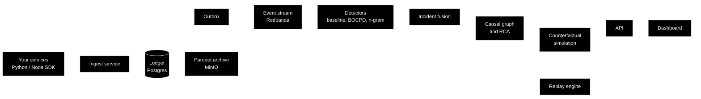

# Tracelore

Tracelore collects telemetry events from your services, stores them in a tamper-evident ledger, detects anomalies, and helps you find the root cause of incidents.

You can also replay past state and ask "what if" questions on a real incident.

---

## What it does

- **Collect** events through a Python or Node SDK.
- **Store** them in an append-only ledger. Every event is linked by a hash chain, so edits can be detected.
- **Detect** anomalies in metrics and in trace sequences.
- **Explain** incidents with a causal graph and root cause evidence.
- **Simulate** counterfactuals ("what if this service was faster?") and backtest them.
- **Replay** history to rebuild state at any point in time.
- **Archive** old data as Parquet files in object storage.
- **Explore** everything in a web dashboard.

---

## How it works



---

## Project layout

```
backend/
  ingest/        ingest service, validation, rate limit
  ledger/        roles, partitions, migrations, repository, chain verifier
  replay/        pure reducers, digests, snapshots
  ml/
    baseline/    minute aggregates, seasonal ranges
    anomaly/     BOCPD, n-gram detector, incident fusion
    causal/      causal graph, RCA evidence
    counterfactual/  simulation and backtest
    compression/ Parquet codec, object store tiering
  api/           HTTP and WebSocket API
  workers/       background jobs and scheduler
sdk/             Python and TypeScript SDKs
dashboard/       web dashboard
bench/           demo services, fault injector, scorer
infra/           Caddy, Prometheus, Grafana, production Postgres
scripts/         setup and helper scripts
tests/           unit, integration, load, ml
```

---

## Requirements

- Python 3.12
- Node.js 20 or newer
- Docker Desktop
- Optional: PyTorch (CPU) for the ML model tests and ONNX export

---

## Quick start

These commands are for Windows PowerShell.

**1. Python environment**

```powershell
Set-ExecutionPolicy -Scope Process Bypass
python -m venv .venv
.\.venv\Scripts\Activate.ps1
python -m pip install -r requirements-dev.lock
```

**2. Create the local `.env`**

```powershell
python scripts/setup.py
```

The `.env` file is gitignored and never pushed.

**3. Start the database and run migrations**

```powershell
docker compose up -d --wait postgres
python -m backend.ledger.migrate
```

**4. Dashboard**

```powershell
cd dashboard
npm ci
cd ..
```

---

## Running tests

Unit tests (no Docker needed):

```powershell
python -m pytest -q -m "not integration"
```

Integration tests (need Docker services):

```powershell
docker compose up -d --wait postgres
python -m backend.ledger.migrate
python -m pytest -q -m integration tests/integration/test_ledger.py
docker compose down
```

Some integration tests also need Redpanda, MinIO or Redis. Start the matching service first.

Dashboard tests:

```powershell
cd dashboard
npm run lint
npm test
cd ..
```

ML model tests need PyTorch. Without it they are skipped:

```powershell
python -m pip install --extra-index-url https://download.pytorch.org/whl/cpu -r requirements-ml.lock
```

Code checks:

```powershell
ruff check .
python scripts/check_style.py
```

---

## Tech stack

| Area | Tools |
| --- | --- |
| Backend | Python 3.12, asyncpg |
| Ledger | PostgreSQL |
| Messaging | Redpanda (Kafka compatible) |
| Archive | Parquet (pyarrow), MinIO |
| Dashboard | Next.js, TypeScript, Vitest, Playwright |
| Monitoring | Prometheus, Grafana |
| Proxy | Caddy |
| Optional ML | PyTorch, ONNX |

---

## Production

A production setup is in `docker-compose.production.yml`. It uses Caddy as the entry point and Prometheus with Grafana for monitoring. Dashboards are in `infra/grafana/dashboards`.

---

## License

See the `LICENSE` file.
